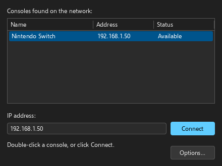
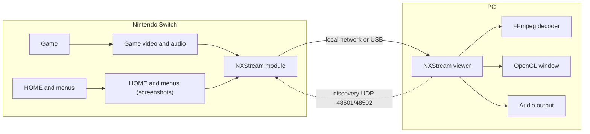
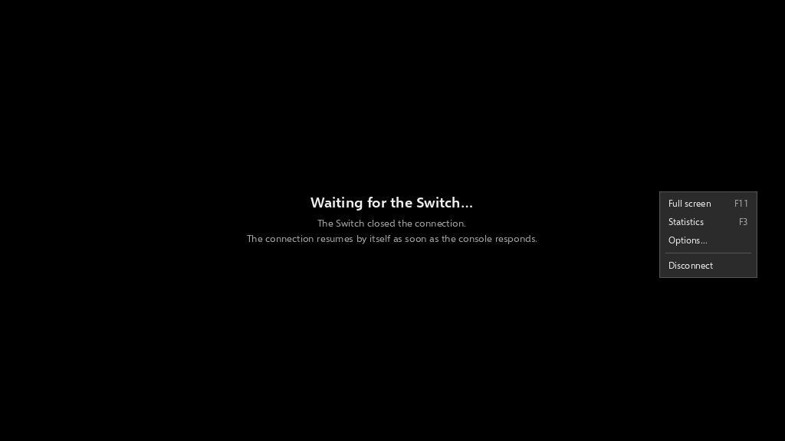
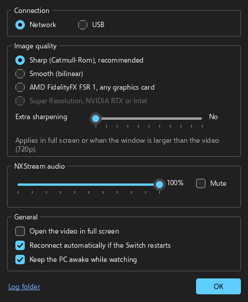

# NXStream

Watch your Nintendo Switch screen on your PC over the local network or a USB cable, with audio.
It works with games, the HOME menu, system menus and homebrew.

<p align="center">
  
</p>

The screenshots show the Linux version. The Windows version looks the same, with native
Windows windows.



## Requirements

- Switch with Atmosphère, firmware 10.0.0 or later.
- Windows 10/11 or Linux x86_64 PC with OpenGL 3.3, on the same network as the console.

## Installation

Download the files from the [Releases](../../releases) page.

The Switch part and the PC app (the client) have separate version numbers and separate releases:

- `switch-vX.Y.Z`: the Switch module and app (`NXStream-X.Y.Z-switch.zip`).
- `client-vX.Y.Z`: the PC app for Windows and Linux.

Take the newest release of each. Both sides check for updates when they start and only offer
the side that changed.

### Switch

1. Download `NXStream-<version>-switch.zip` from the newest `switch-v` release, or build it (see below).
2. Extract it to the root of the SD card.
3. Reboot the console. The module starts about 15 seconds after boot.

### Windows

1. Download `NXStream-<version>-windows-x64.exe` from the newest `client-v` release. FFmpeg is built in: just run it.
2. The consoles it finds appear in the list: double click to watch.
   Or type the IP and press *Connect*, or run `NXStream.exe <console IP>`.

### Linux

1. Download `NXStream-<version>-linux-x86_64.AppImage` from the newest `client-v` release and make it executable:
   `chmod +x NXStream-<version>-linux-x86_64.AppImage`.
2. Run it. Options and keys are the same as in the Windows version. The only
   difference is that the Super Resolution mode is greyed out.

## Usage

| Key | Action |
|---|---|
| F11, Alt+Enter, double click | full screen |
| Esc | leave full screen |
| F3 | statistics |
| right click | menu: Full screen, Statistics, Options…, Disconnect |

If the console reboots, goes to sleep or loses Wi-Fi, the window stays open and the video
resumes by itself as soon as the module answers.

<p align="center">
  
</p>

Options include image quality, sharpening and the NXStream volume, which does not change the
system volume. You can also start in full screen, reconnect automatically and keep the PC awake
while you watch. Windows follow the system light or dark theme.

*Show what I'm playing on Discord* puts the game you are playing, its icon and the play time
in your Discord status. Homebrew shows up as homebrew, the HOME menu as "In the HOME menu".
It is off by default.

### Image quality on the PC

The video is 1280×720. This setting only matters when the window is bigger than that.

<p align="center">
  
</p>

| Mode | What it does |
|---|---|
| Sharp (default) | Crisp picture. A good choice for most people. |
| Smooth | Softer picture. Hides blocky compression. |
| AMD FidelityFX FSR 1 | Sharper upscaling on big screens. Works on any graphics card, a bit heavier. |
| Super Resolution | Best quality. With an NVIDIA RTX card (turn on RTX Video Enhancement in the NVIDIA app) or a recent Intel GPU. Windows only. |

*Extra sharpening* makes the picture crisper, but at high values compression blocks show up too.

Which one should I use?

- RTX or recent Intel GPU on Windows: Super Resolution.
- Otherwise, on a big TV or monitor: FSR 1.
- Small window or low bitrate: Smooth.
- Not sure? Leave it on Sharp.

### NXStream app on the Switch

| Section | Items |
|---|---|
| Status | Module, Streaming, PC connected, IP address, Console name, Start module |
| Connection | Network or USB, Resolution (720p or 1080p) |
| Games | Video quality preset, Quality (bitrate), Frames per second, Full frame every, Game video, Game audio |
| HOME | HOME and system menus, HOME frame rate, HOME max bandwidth |
| System | Auto-start, Reset to defaults |

Use the buttons or the touchscreen: tap a section, a setting or its arrows. Settings that do not
apply to the current connection or resolution are greyed out.

Video quality presets:

- Standard: 5 Mbps, 30 fps (any Wi-Fi)
- High: 10 Mbps, 30 fps (recommended)
- Very high: 15 Mbps, 30 fps (strong 5 GHz Wi-Fi)
- High 60: 10 Mbps, 60 fps (good Wi-Fi)
- Very high 60: 15 Mbps, 60 fps (strong 5 GHz Wi-Fi)

Video quality changes apply after restarting the console. Other settings apply at once.

## USB connection

Instead of Wi-Fi you can stream over a USB-C cable.

1. On the Switch, open NXStream and set the connection to USB (undocked, cable plugged
   into the console and the PC).
2. In the viewer, open *Options* and choose USB.

The first time, Windows asks to install a USB driver so the Switch can be detected. On Linux
the viewer asks for your password once to allow USB access. While USB is on, other USB apps
on the Switch cannot use the cable.

## 1080p

Set *Resolution* to 1080p in the Switch app and restart the console. Games then draw their
docked picture also in handheld mode, and the PC gets it at 1920×1080. The frame rate is a
steady 30 fps, or lower when the console can't keep up. HOME stays at 720p. It uses more
battery: for smooth 60 fps play, stay on 720p.

## Limitations

- At 720p the picture is 1280×720, also when the console is docked. 1080p runs at 30 fps at most.
- Some games block recording. NXStream still shows them, at a lower frame rate.
- A VPN on the PC can cause problems: turn it off while you use NXStream.

## Log

If something goes wrong, these files help find the problem. They contain no IP addresses or
personal names.

- Switch: `sd:/config/nxstream/log.txt` (previous session: `log.prev.txt`), with 1080p also
  `sd:/config/nxstream/tap/log.txt`
- Windows: `%LOCALAPPDATA%\NXStream\log.txt` (previous: `log.old.txt`)
- Linux: `~/.local/share/NXStream/log.txt`

## Building

### Switch

You need [devkitPro](https://devkitpro.org/wiki/Getting_Started) with `switch-dev` and, for the
app, `switch-sdl2 switch-sdl2_ttf switch-sdl2_image`. The first build downloads and compiles the
libraries the 1080p module needs.

```sh
bash switch/build.sh
```

### Windows

```powershell
powershell -ExecutionPolicy Bypass -File pc/build-windows.ps1
```

### Linux

You need the .NET 8 SDK, SDL2, SDL2_image, SDL2_ttf and libusb 1.0.

```sh
bash pc/build-linux.sh
```

## Third-party software

[FFmpeg](https://ffmpeg.org) is built into the Windows exe (LGPL build from
[BtbN/FFmpeg-Builds](https://github.com/BtbN/FFmpeg-Builds), license included in the release).
The Linux AppImage includes a GPL build from the same project. The FFmpeg source code is available at
[ffmpeg.org/download.html](https://ffmpeg.org/download.html).

[libusb](https://libusb.info) (LGPL-2.1) is bundled in both viewers for the USB connection; the
Windows exe carries its license text.

The Linux viewer bundles SDL2 (zlib license) and the Selawik, Inconsolata and DejaVu fonts
(licenses in `pc/packaging/linux/fonts`).

## License

NXStream is licensed under the PolyForm Strict License 1.0.0. See [LICENSE](LICENSE) and [NOTICE](NOTICE).
The 1080p module in `switch/tap` is licensed under the GPL-2.0, see its
[LICENSE](switch/tap/LICENSE) and [NOTICE](switch/tap/NOTICE).

Contributions are welcome: see [CONTRIBUTING.md](CONTRIBUTING.md).
